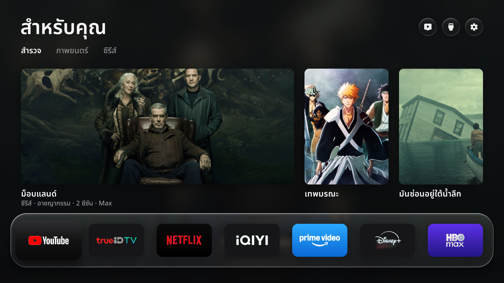

# Free My TV Thai

A personal, bilingual home screen for Android TV, focused on Xiaomi TV Box S and Mi Box.

Choose the apps and their order. See recommendations from your own apps, local weather, and a screensaver that follows the time of day. Thai and English are included.

[Install](INSTALL.md) · [AI setup prompt](PROMPT.md) · [Compatibility](docs/COMPATIBILITY.md) · [Recovery](docs/RECOVERY.md) · [Xiaomi ad cleanup](docs/MI_BOX_ADS.md)



## What you get

- **Your apps on the home screen.** Choose any installed TV apps and arrange them in your preferred order. Seven apps fit on each page; continue with the remote to reach more.
- **Thai and English.** Thai interface, weather text, and movie details with Noto Sans Thai. The app credits the translation to **FB : Kiw Kiattisak** in the settings screen.
- **Recommendations, if you want them.** Trending titles are matched to the streaming apps available in your country. Add your own TMDB key locally; the home screen and app dock work without one.
- **Weather and daylight.** A local forecast, sunrise and sunset, using Open-Meteo.
- **A matching screensaver.** Free My TV can become both Home and the screensaver.
- **Optional Xiaomi ad cleanup.** A small, documented set of ad and analytics packages can be disabled and restored. It does not remove ads inside streaming services.
- **One place to undo.** Choose **Home Screen → Original** to return to the recorded Home, screensaver, and package states. No system apps are uninstalled.

This is an independent adaptation of [Free My TV](https://github.com/simbasjungles/free-my-tv), not an official Xiaomi, Google, or streaming-service release. The source retains the upstream MIT license and third-party notices.

## Install

You need an Android TV / Google TV box running **Android 9 or newer** and a computer on the same local network. The main target is Xiaomi TV Box S 3rd Gen. The ready-to-run setup supports Windows 10/11 x64; its actual build tools are included in the repository.

### The guided way

1. On the TV, enable **Developer options → USB debugging**. Find the TV's IP address in Network settings and keep the TV awake.
2. Download this repository with **Code → Download ZIP** and extract it, or clone it with Git.
3. Open the folder and run `setup.cmd`. If needed, it asks for the TV's debugging address. You can also start it from PowerShell with:

   ```powershell
   .\setup.cmd --connect TV_IP:5555
   ```

4. Answer the setup questions: language, city/country, temperature units, which installed apps to show and in what order, and whether to enable the optional Xiaomi cleanup. For recommendations, enter **your own** TMDB key in the hidden local prompt. Do not paste it into a chat.
5. Accept the debugging authorization prompts on the TV. In Free My TV settings, select **Home Screen → Free My TV** to activate it. Then check the Home screen and apps.

The installer does not need Android Studio or separate downloads for Python, Java, Android build tools, or ADB. See the [full step-by-step guide](INSTALL.md) for pairing, screenshots, upgrades, troubleshooting, and noninteractive commands. The [AI setup prompt](PROMPT.md) tells an assistant which questions to ask first.

### Build and test

```powershell
.\setup.cmd --build-only
.\setup.cmd --self-test
```

A default build contains no TMDB key and no preselected apps. Run the guided setup to build your personal configuration. Each build uses a local signing key; keep `.local/signing/` and `.local/backups/` private so you can update and recover later.

## Compatibility

Free My TV Thai 2.0 requires Android 9 (API 28) or newer. Mi Box 3 devices that remain on Android 6 or 8 are not supported. See [what has and has not been tested](docs/COMPATIBILITY.md): the preceding 1.0 version was observed on a Xiaomi TV Box S 3rd Gen, while 2.0 still needs a fresh on-device and reboot test.

## Going back

On the TV, open Free My TV settings and select **Home Screen → Original**. Keep Free My TV installed until the restore finishes. See [recovery instructions](docs/RECOVERY.md) for interrupted operations and the private computer backup.

## Privacy and services

This repository contains **no TMDB API key**. Recommendations are optional. An APK built with your key contains it, so keep that APK private. Your configuration, signing key, ADB authorization, device details, and recovery backup should stay on your computer.

The app uses TMDB for recommendations and Open-Meteo for weather/geocoding. Those services have their own terms and availability. This product uses the TMDB API but is not endorsed or certified by TMDB.

## Credits and licenses

- Thai translation: **FB : Kiw Kiattisak** (shown in Thai and English in app settings).
- Original Free My TV source: [MIT-licensed project](https://github.com/simbasjungles/free-my-tv).
- Fonts and icons keep their own licenses and notices; see [THIRD_PARTY_NOTICES.md](THIRD_PARTY_NOTICES.md).
- Xiaomi ad package research: [cleanyourtv Mi Box profiles](docs/MI_BOX_ADS.md). Only the ad cleanup research was used.
- App package: `io.freemytv` · Version **2.0** (version code 2).
